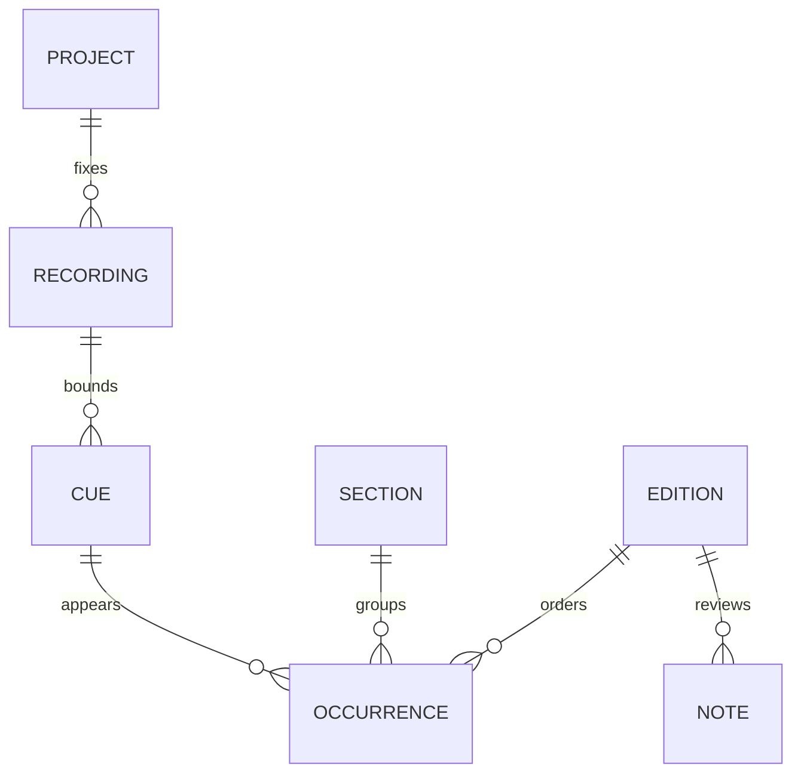

# 领域与本体设计

## 专业聚合

Recording固定录音、Cue原始选段、Section节目章节、Edition单集编排、Occurrence独立出场、Note固定意见。根字段：recordings、cues、sections、editions、notes、basis_refs。专业对象以WorkRef＋owner_plugin_id＋object_id确定身份，revision＋sha256固定内容。相同标题不代表同一对象。

录音与原始选段只追加，逐字转录固定文字来源，入出点依据真实PCM16 WAV帧。转录是提交者声明，合成测试音不冒充真人说话。章节台本与声音分别保存，改台本后旧编排与意见过期。编排固定章节、选段和录音组合摘要；已过期编排不能渲染，明确复核后才重新固定。按单轨顺序拼接选段与真实静音，不默重采样、不修改音高或压缩时长，输入必须同采样率／声道。章节时间从实际输出帧推导，重复章节允许但有独立出场；不从文字猜语音时间。

所有集合ID唯一、所有引用存在、集合有界、顺序在对应父级唯一。撤销先处理依赖，不能制造悬空引用；来源索引只追加，整本保存不能改变原索引意义。跨包引用只携带固定Owner、对象、修订与摘要，通过公开SDK回读，不导入对方私有结构。

## 权属

原始资料、作品身份与受管事务归Core；专业记录归本包；理解、创作与解释归作者选择的外部Agent；表达取舍与定稿归作者。借助欧卡姆原理复用通用事实，只增加本旅程需要的专业状态。
